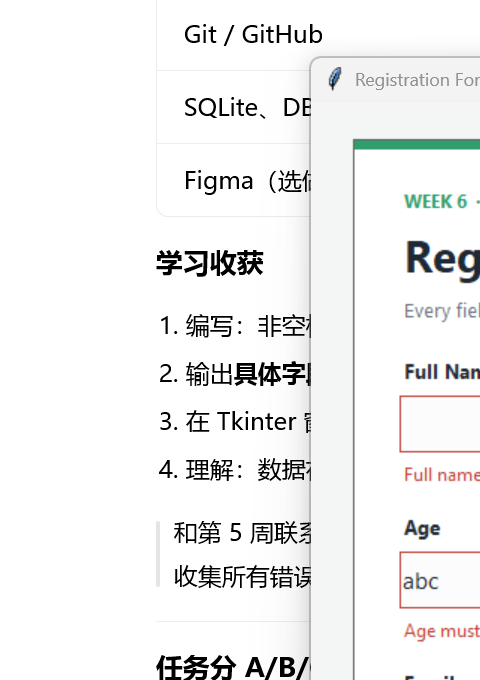
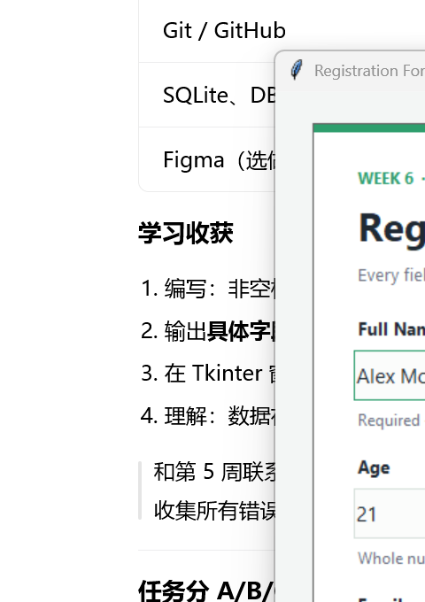

# Week 6 Practical - Registration Form

A Tkinter registration form that validates every field **before** accepting a
submission, built for the Week 6 Input Validation practical.

The form rejects blank names, non-numeric or out-of-range ages, and malformed
email addresses. Each failed rule shows a clear, field-specific error message;
a fully valid submission shows a green success message and is saved to a local
SQLite database.

**GitHub repository:** https://github.com/youjun2007/week6-registration-form

## Screenshots

| Validation errors | Successful submission |
| --- | --- |
|  |  |

## Validation rules

| Field | Rule | Error message |
| --- | --- | --- |
| Full Name | Cannot be blank or only spaces | `Full name is required.` |
| Age | Must be a whole number | `Age must be a whole number.` |
| Age | Must be between 0 and 120 inclusive | `Age must be between 0 and 120.` |
| Email | Cannot be blank | `Email is required.` |
| Email | Must match `name@domain.tld` | `Enter a valid email address, e.g. name@example.com` |

`on_submit()` collects every field result, shows all inline errors, and displays
the first failing message in the status bar. No database row is written unless
every check passes.

## Run the app

Requires Python 3.10+ with Tkinter (included in the standard Windows Python
installer). No third-party packages are needed for the application itself.

```bash
python registration_form.py
```

The app creates `registrations.db` in the project folder on first launch. That
file is ignored by Git because it contains runtime data.

## Run the automated tests

```bash
python -m unittest discover -s tests -v
```

The suite contains 13 tests covering:

- required-field, age-range and email-format validation;
- boundary ages (`0`, `120`) and invalid values (`abc`, `-5`, `200`, `21.5`);
- malformed emails (missing `@`, missing dot, containing a space);
- the real `on_submit()` flow and its inline/status messages;
- live email validation as the user types;
- SQLite insert and row count.

Expected result:

```text
Ran 13 tests in 0.4s

OK
```

## Optional extensions

Both optional extensions from the handout are implemented:

1. **Real-time email validation** - `on_email_key_release()` validates the email
   field on every key press and updates the inline error immediately. The final
   `on_submit()` check is still kept as the authoritative validation.
2. **SQLite storage** - only fully valid registrations are inserted into
   `registrations.db`. The footer shows how many records are stored and the id
   of the newest row.

### Database schema

```sql
CREATE TABLE registrations (
    id         INTEGER PRIMARY KEY AUTOINCREMENT,
    name       TEXT    NOT NULL,
    age        INTEGER NOT NULL CHECK (age BETWEEN 0 AND 120),
    email      TEXT    NOT NULL,
    created_at TEXT    NOT NULL
);
```

Inspect the data with DB Browser for SQLite, or run:

```bash
python -c "import sqlite3; print(sqlite3.connect('registrations.db').execute('SELECT * FROM registrations').fetchall())"
```

## Project structure

```text
Week6_Practical_Registration_Form/
|-- registration_form.py       # Tkinter app + validation + SQLite helpers
|-- tests/
|   `-- test_validation.py     # 13 automated tests
|-- screenshots/
|   |-- registration_form.png
|   `-- validation_errors.png
|-- .gitignore
`-- README.md
```

## Implementation notes

- `validate_required(value, field_name)` returns `None` on success, otherwise a
  field-specific message.
- `validate_age(value)` uses `int()` inside `try/except ValueError`, then checks
  the inclusive `0..120` range.
- `validate_email(value)` uses `EMAIL_PATTERN = r"^[^\s@]+@[^\s@]+\.[^\s@]+$"`
  from the lecture.
- Values are stripped before saving, so accidental leading/trailing spaces do
  not create inconsistent records.
- Database errors are caught and shown in the status bar instead of crashing
  the app.

## Submission checklist

- [x] `registration_form.py` runs without errors
- [x] Blank Name or Email is rejected with a clear message
- [x] Non-numeric or out-of-range Age is rejected
- [x] Malformed Email is rejected
- [x] A fully valid submission shows a success message
- [x] At least 3 meaningful Git commits made during the build
- [x] Code pushed to the GitHub repository
- [x] Optional: live email validation while typing
- [x] Optional: validated records inserted into SQLite
- [x] Automated tests included and passing (13 tests)